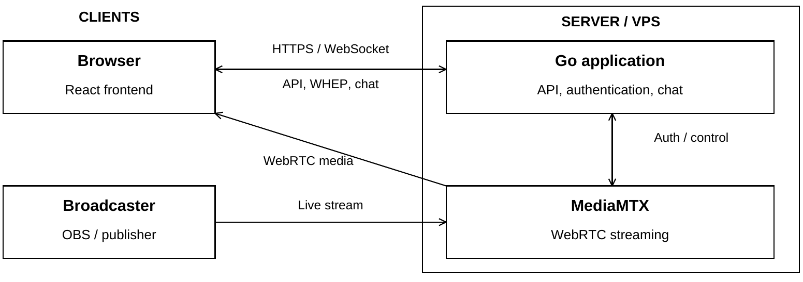
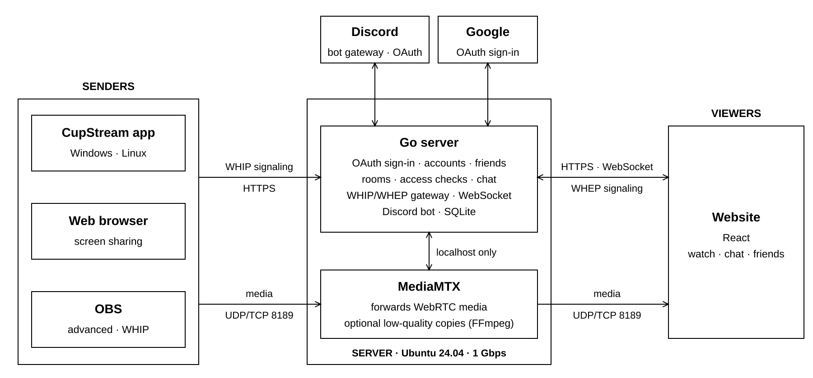

# CupStream: project overview and development plan

*CT70A9800 Full Stack Development*

A live streaming web application that will be expanded into a multi-room streaming service, combining public broadcasts with private streams shared among friends. A hybrid between Twitch and Discord streaming.

I started this project a few months ago as an early prototype, but it was just supposed to be a quick way to share low-latency, high-quality streams with my friends. I will continue developing it into a fully fledged streaming platform. The end goal and main evaluation criterion are whether users can easily share live content with one another.

This document describes the current implementation, the planned scope and architecture, the main technical decisions and the implementation plan. I am developing the project alone, so the plan delivers a usable end-to-end product early and tests the riskiest part, desktop capture and packaging, with a prototype before building on it.

## 1. Current implementation

**Frontend:** React 18, TypeScript, Vite and Tailwind CSS, with React Router, TanStack Query and Zustand. The interface provides a stream player, live/offline status, viewer count and text chat.

**Backend and media:** Go 1.22 serves the frontend and HTTP API, MediaMTX handles WebRTC media; the Go service proxies WHEP playback signaling and the media control API. Docker Compose and GitHub Actions build/smoke-test configuration are included.

**Current state:** The UI targets one stream only. Viewers choose a display name and enter a shared password; there are no individual accounts. There is only one credential configured for a single broadcaster. Chat stores the latest 100 messages in memory and is lost on restart. HLS is disabled.

### 1.1 Current client-server architecture

## 2. Product scope

CupStream will let people go live from a desktop app, a browser or OBS, and watch together on the website. Rooms come in two types: Discord rooms, which follow a Discord voice channel, and link rooms, which are shared through invites and links.

### 2.1 In scope

- **Three ways to go live:** the CupStream desktop app for Windows and Linux (recommended), streaming from the browser (no installation, with documented limitations), and OBS over WHIP for advanced users.
- **Multi-streamer rooms:** several people can stream into the same room at once, and viewers choose one or more streams to watch.
- **Two room types:** Discord rooms, tied to a voice channel and governed by Discord permissions, and link rooms (one per user), managed entirely by CupStream.
- **Accounts:** sign-in with Google or Discord only (OAuth). Linking a Discord account is required for Discord features.
- **Friends:** chosen explicitly, with suggestions from CupStream users who share a Discord server.
- **Discord bot:** tracks voice channels, enables Discord rooms and posts live-status messages.
- **Chat:** WebSocket chat in every room; messages expire after 24 hours.
- **Viewing:** on the website only, over WebRTC with sub-second latency.
- **Live only:** no recordings.

### 2.2 Out of scope for now

- **LL-HLS playback:** WebRTC only at first; LL-HLS may be added later for very large public rooms.
- **Recordings and video on demand.**
- **A public discovery page:** rooms are reached through links, friends and Discord.
- **A macOS desktop app, and streaming from mobile devices:** mobile browsers cannot capture the screen.
- **A Discord Activity** (watching inside Discord): Discord routes all Activity traffic through its own proxy, which supports HTTP and WebSockets but not WebRTC, so it would need a separate playback path. Explored and dropped.
- **Code signing for the Windows app:** it ships unsigned, with a SmartScreen warning on first install.

## 3. Planned architecture

The Go server is the only public entry point for HTTP and WebSocket traffic. It handles sign-in, rooms, friends, the realtime WebSocket (chat, presence and stream events), the Discord bot and all WHIP/WHEP signaling, and stores its data in SQLite. MediaMTX only forwards media. It runs from our own build, which adds pausing and resuming of viewer sessions (see 3.2). Its HTTP interface listens on localhost only, so every publish and playback request has to pass Go's access checks. Media packets travel directly between clients and MediaMTX over UDP, with a TCP fallback, on port 8189.

Everything runs on one dedicated server: an AMD Ryzen 9 9950X3D (16 cores) with 128 GB of RAM, running Ubuntu Server 24.04, with a guaranteed, unmetered 1 Gbps connection. The network, not the CPU, is the capacity limit (see 9.3).

### 3.1 Key technical decisions

<!-- widths: 16,44,40 -->
| Area | Decision | Reason |
|---|---|---|
| Media gateway | Go forwards all WHIP (publish) and WHEP (playback) signaling to MediaMTX, which listens on localhost only. | One place decides access, OBS stream keys never reach MediaMTX, and Go records every viewer session so it can end it when access changes. |
| Stream paths | Each stream gets its own MediaMTX path (`s/<streamId>`) with a server-generated ID; the room a stream belongs to is only a record in Go. | Clients cannot choose or take over paths, and a stream can move between rooms without restarting. |
| Live state | Go knows when publishing starts from the WHIP request and reconciles with MediaMTX's API every 2 seconds. | No hook scripts; the state recovers by itself after a restart. |
| Database | SQLite (WAL mode) with goose migrations and sqlc-generated queries; continuous backups with Litestream. | One server and simple operations; nothing in scope needs a separate database server. |
| Realtime | One WebSocket per browser tab that subscribes to rooms; it carries chat, presence, stream events, notifications and viewer statistics. | A single connection covers both app-wide and room events. |
| Authentication | OAuth only (Google OpenID Connect and Discord). Server-side sessions stored in the database, identified by an opaque HttpOnly cookie. | Logout and revocation take effect immediately, and there are no passwords to store. |
| Discord bot | Runs inside the Go server (discordgo) with only the non-privileged GUILDS and GUILD_VOICE_STATES intents. | It shares in-memory voice state with the access checks and needs no approval from Discord. |
| Codecs | H.264 without B-frames by default, AV1 optional, HEVC refused; Opus audio. | Without transcoding, every viewer must be able to decode what the sender sends. |
| Desktop app | Tauri 2 (Rust) with GStreamer through gstreamer-rs; WHIP through the Rust `whipclientsink` element built into the app. | Hardware encoders and per-application audio capture; the settings UI can reuse the website's React components. |
| Transcoding | None by default; optional on-demand low-quality versions through MediaMTX's `runOnDemand` and FFmpeg. | Forwarding keeps latency minimal, and the server's CPU allows a few transcodes when viewers need them. |
| Pausing viewers | Our MediaMTX build can pause and resume a viewer's session without closing it (3.2). | Media to a viewer can stop instantly and resume in a fraction of a second, without a new connection. |

### 3.2 MediaMTX build: pausing viewer sessions

MediaMTX is built from a pinned release plus our patch, which starts from the open pull request [bluenviron/mediamtx#6308](https://github.com/bluenviron/mediamtx/pull/6308) ("allow pausing and resuming WHEP sessions"). That PR stops sending media to one viewer while keeping the WebRTC connection alive; on resume, video waits for the next keyframe and RTP sequence numbers stay continuous. We review and test the code ourselves, and the following changes are made in our MediaMTX build, not in CupStream's Go server.

The build lives in a fork, [RAdu2005/mediamtx](https://github.com/RAdu2005/mediamtx). Each branch `cupstream/<release>` starts from an upstream release tag, adds the PR's commit unchanged, then our changes as separate commits, and is tagged `<release>-cupstream.<n>` (currently `v1.21.2-cupstream.1`, the PR only). CupStream's MediaMTX image is built from that tag, so development, CI and production run the same binary. Our changes are offered upstream as comments on the PR or as follow-up PRs.

The changes:

1. **Keyframe request on resume.** Resuming asks the stream's source for a keyframe straight away (a PLI to WebRTC publishers), limited to one request per stream every 300 ms so a burst of resumes shares one keyframe. RTMP and SRT sources cannot be asked and keep their own keyframe interval.
2. **Control through the localhost API only.** New endpoints `POST /v3/webrtcsessions/pause/{id}` and `/resume/{id}`, a configuration flag that disables the public JSON `PATCH`, and the session ID returned in a response header of the WHEP `POST` so Go can map sessions to viewers.
3. **No hanging requests.** A pause request that arrives before the connection exists is stored and applied once it does, or answered with 409, instead of blocking until the session ends.
4. **Paused timeout.** A session that stays paused longer than a configurable time (`webrtcPausedTimeout`, 2 minutes by default) is closed, in case Go never sends its `DELETE`.
5. **Paused state in the API.** `/v3/webrtcsessions` reports `paused` and `pausedSince`, so Go can rebuild its view after a restart.
6. **Per-track pause.** The request can pause video and audio separately, for example `{"video": false, "audio": true}`.
7. **Start paused without a preview frame.** `?paused=true&preview=false` opens a session that sends nothing until resumed, so pre-warming a room does not cost a burst of keyframes.
8. **Lock-free fast path.** The per-packet check uses an atomic flag; the mutex is only taken when the state changes.
9. **Keyframe retry.** If no keyframe arrives within about 2 seconds of a resume, the request is repeated and logged.

The patch also gets tests for the Opus, VP8/VP9 and AV1 paths, pausing before the connection is up, rapid pause/resume toggling under `-race`, resuming on a stream with a long keyframe interval, and a throughput comparison with and without the patch. It is kept small and rebased onto each MediaMTX release we upgrade to. Go checks at startup whether the build supports pausing and otherwise falls back to closing sessions, so the fork can be dropped if upstream merges a different design.

**Where CupStream uses it:**

- **Leaving a Discord voice channel:** the viewer's media is paused 1–2 seconds after they leave and the session is closed after 2 minutes; rejoining within that time resumes it (see 4.3).
- **Background tiles:** streams that are not in focus can be paused and resumed almost instantly, which is also the main action of the bandwidth warning (7.2).
- **Pre-warmed rooms:** every stream in a room is opened paused, so switching streams only waits for a keyframe (7.1).
- **Hidden tabs:** muted tiles are paused and the focused stream drops to audio only while the tab is hidden (7.1).
- **Capacity:** near the bandwidth limit, background and hidden-tab sessions are paused before new viewers are refused (9.3).
- **Moving a stream to a link room:** viewers who were not ticked are paused instead of disconnected, so the owner can let them back in instantly (4.4).

## 4. Rooms and access control

### 4.1 Room types

<!-- widths: 18,41,41 -->
| | Discord room | Link room |
|---|---|---|
| Owner | The Discord server; one room per voice channel | A user; every user has exactly one link room |
| Who can watch | People currently in the voice channel who are signed in with Discord | Depends on visibility: everyone (no login), signed-in users, or invite only |
| Who can stream | Members with Discord's Video permission in the channel (default), or anyone in the channel (server setting) | The owner and the people they allowed to stream |
| Leaving voice | Viewers' media pauses after 1–2 seconds and their session closes after 2 minutes; streams end after a 10–15 second grace period | No effect |
| Moderation | Based on Discord permissions | The owner |
| Discord bot | Required; posts and updates a status message in the voice channel's text chat | Not involved |
| Conversion | A streamer can move their own stream to their link room | Cannot become a Discord room |

Each room type has exactly one source of truth for permissions, Discord or CupStream, so the rules never mix. Nobody is ever added to a room automatically: access to a Discord room is calculated from voice presence, and a link room only admits people its owner explicitly allowed.

### 4.2 Link rooms

- **Visibility:** *Everyone* (anyone with the link, no login needed; chatting requires sign-in), *Signed-in* (any CupStream user with the link) or *Invite only*.
- **Allowed people:** in an invite-only room, the owner chooses who may enter, usually from their friends list. They stay allowed until removed, and can be marked as able to stream (co-streamers).
- **Invite links:** anyone who opens a valid link can watch while the link is valid. The owner sets the expiry (1 hour, 24 hours, until the stream ends, or never), an optional use limit, and whether the link allows streaming. Revoking a link removes everyone who joined through it. People using a link must sign in, and they are never added to the allowed list.
- **Kicks and bans:** the owner can kick a viewer, which ends their session and temporary access, or ban them, which also blocks invite links.

### 4.3 Discord rooms

- **Watching:** being in the voice channel and signed in with Discord is the only way in. Someone who opens the room's link without being in the channel is asked to join it, with a link that opens the channel in Discord. Server and channel names are only shown to members of that server.
- **Streaming:** by default the bot mirrors Discord's own rule: only members with the Video (Go Live) permission in the channel can stream. The bot calculates this from roles and channel permission overrides, which it receives without privileged intents. Server admins can instead allow anyone in the channel. If someone loses the permission while live, their stream ends after the grace period.
- **Moderation:** members with Move Members in the channel can end someone else's stream, and members with Manage Messages can delete chat messages. A viewer is removed by disconnecting them from voice in Discord; the grace-period rule does the rest.
- **Leaving voice (viewers):** 1–2 seconds after a viewer leaves or switches channels, their media is paused (3.2), so they stop receiving the stream almost immediately; the short delay only absorbs quick leave-and-rejoin flaps. If they rejoin within 2 minutes, the session resumes without a new connection; otherwise it is closed.
- **Leaving voice (streamers):** publishing sessions cannot be paused, so a streamer's stream ends 10–15 seconds after they leave; rejoining within that time cancels it. The streamer sees a countdown with a *Move to my link room* button (see 4.4).
- **Status message:** the bot posts one message in the voice channel's text chat that lists the live streams and links to the room. It edits the message as streams start and stop (at most once every few seconds, because of Discord's rate limits) and deletes it when the room goes idle.
- **Reliability:** if the bot loses its connection to Discord, all pauses, kicks and stream endings wait until its voice state is up to date again, so a bot restart never ends anyone's stream. Removing the bot from a server or deleting the voice channel ends that room's streams with a clear reason.
- **Chat:** Discord rooms use the same CupStream chat, collapsed by default. It is not mirrored to Discord, because reading Discord messages requires the privileged Message Content intent.

### 4.4 Going live and moving streams

- **One live stream per user:** a user can only be live in one place. Going live elsewhere asks for confirmation to end the current stream first. OBS cannot show a prompt, so it is refused and the question appears on the website or in the desktop app instead. A sender reconnecting its own dropped stream does not count as a second stream.
- **Start mode:** a user setting decides where a new stream goes. With *Discord (auto)*, it goes to a Discord room when the user is in a voice channel on a server with the bot and may stream there; otherwise the user is told why and offered their link room. With *Link room*, it always goes to the user's link room.
- **Moving a stream to a link room:** a streamer can move their own stream from a Discord room into their link room, for example to keep streaming after leaving voice, or by choosing *Open to everyone*. The stream keeps its media path, so the video is not interrupted, and the chat history stays with the Discord room.
- **Who keeps watching after a move:** the link room keeps its visibility, or switches to *Everyone*. If it is invite only, people on the allowed list keep watching. The dialog lists the other current viewers with checkboxes, ticked by default; ticked viewers get temporary access until the stream ends, and nothing is saved unless the owner chooses *Always allow*. Unticked viewers are paused rather than disconnected, so the owner can still let them in without them reconnecting; their sessions close after the paused timeout.
- **No move in the other direction:** to stream in a Discord room, the user ends the stream, joins a voice channel on a server with the bot and goes live again.

## 5. Accounts, friends and Discord integration

### 5.1 Sign-in and accounts

- Sign-in uses OAuth only: Google (OpenID Connect, scopes `openid profile`) and Discord (scopes `identify guilds`). The first sign-in creates the account, so a guest arriving from a Discord message only sees one consent screen.
- The other provider can be linked later from the settings page; Discord features require a linked Discord account. Accounts are never merged automatically by email address. If an identity already belongs to another account, the user must confirm the merge or cancel.
- Handles are unique, prefilled from the Discord username or the Google name, and editable.
- Sessions are random tokens stored hashed in the database. Users can see and revoke their sessions, including desktop-app logins.

### 5.2 Friends

- A friendship is a request that the other person accepts. Without acceptance, anyone could add someone and see when they go live.
- Suggestions are CupStream users with a linked Discord account who share a Discord server. Users can turn individual servers off for suggestions; very large servers are off by default, using the approximate member count that Discord returns.
- Server lists change, so the Discord refresh token is stored encrypted and the list is refreshed at sign-in and daily for active users.
- Importing the Discord friends list directly is not possible without approval: the `relationships.read` scope requires applying to Discord and accepting the terms of its Social SDK, which is aimed at games.
- Friends see each other's live status only for rooms they are allowed into, and a friend can be added to the allowed list in one click.

### 5.3 Discord bot

- Server admins install it with the `bot` and `applications.commands` scopes and the View Channels, Send Messages and Embed Links permissions. It never joins voice.
- It tracks voice channels with the non-privileged GUILDS and GUILD_VOICE_STATES intents: a snapshot when it connects, then voice-state updates kept in memory. Voice states of people who do not use CupStream are never stored.
- Server settings use the `/cupstream settings` slash command, limited to members with Manage Server: who may stream (Video permission or anyone in the channel), status messages on or off, and which voice channels are tracked.
- Discord rooms only exist in servers, because bots cannot see direct-message or group calls. Discord requires verification once a bot is in more than 100 servers.

## 6. Streaming clients

### 6.1 Going live

The interface promotes the desktop app first, then streaming from the browser, with OBS as an advanced option. The go-live dialog offers:

1. **CupStream app (recommended).** While it runs in the tray, the app keeps a WebSocket connection to the server, so the website knows it is available and can ask it to open its screen picker. If the app is installed but not running, a `cupstream://` link starts it; otherwise the website offers the download for the visitor's operating system.
2. **Stream from this browser,** with the limitations of the current browser shown inline and a suggestion to use the app when they apply.
3. **OBS (advanced),** collapsed by default: WHIP server URL, stream key and start mode.

All three use the same API: the client asks the server to start a stream, receives a WHIP URL and a token that is valid for that stream only, and publishes. OBS uses its stream key as the token.

### 6.2 Desktop app (Windows and Linux)

A tray application with one button to go live, a Discord-style picker for screens and windows, quality settings, audio that leaves out Discord, and the choice of room. After going live, it copies the room link to the clipboard. It is built with Tauri 2 and GStreamer.

<!-- widths: 16,42,42 -->
| | Windows | Linux (Ubuntu 24.04+, Fedora, Arch) |
|---|---|---|
| Capture | Windows.Graphics.Capture (`d3d11screencapturesrc`) with the app's own picker showing windows and monitors with thumbnails | The system screen-sharing dialog (xdg-desktop-portal) and PipeWire; a saved restore token avoids asking every time; `ximagesrc` on X11 |
| Encoders | NVENC, AMF, Quick Sync, Media Foundation; x264 as fallback | VA-API (Intel, AMD), NVENC; x264 or OpenH264 as fallback |
| Audio without Discord | WASAPI process loopback that excludes Discord's process tree (`wasapi2src`); needs Windows build 20348 or later, in practice Windows 11. Windows 10 falls back to all system audio with a warning | A PipeWire virtual sink that receives every application's audio except Discord and Vesktop (the approach used by venmic); no exclusion on PulseAudio-only systems |
| Tray | Native | AppIndicator; GNOME needs an extension (Ubuntu ships it, Fedora does not), so the app also works from a small window |
| Packages | Unsigned NSIS installer (per user, no admin rights) with a trimmed GStreamer bundle | .deb and .rpm packages that use the system's GStreamer and GPU drivers; an AUR package for Arch |
| Updates | Tauri updater with signed update files | Tauri updater (supports .deb and .rpm since plugin version 2.10) or the package manager |

- **Sign-in:** the app opens the CupStream login page in the system browser, which redirects back to the app on a local port (OAuth with PKCE). The app keeps a revocable refresh token in the operating system's keychain.
- **Settings:** resolution and frame-rate presets up to 4K at 60 fps, codec (H.264 or AV1), bitrate (automatic or manual), encoder (detected automatically), audio mode (everything except Discord, everything, one application, or none), start mode and link-room visibility. A global hotkey starts and stops the stream; on Wayland it uses the GlobalShortcuts portal.
- **Quality:** the app can publish a second, low-quality version of the stream for viewers on slow connections, and adjusts its bitrate when the server reports that viewers are struggling.
- **Limits:** only the Discord desktop app can be excluded; Discord running in a browser tab cannot be separated from the browser's other audio. A streamer watching their own stream on the same computer has to mute it to avoid an echo.
- **Unsigned Windows build:** the first install shows SmartScreen's *Windows protected your PC* warning (More info, then Run anyway), which the download page explains. Updates installed by the app normally do not trigger it. Antivirus false positives are possible, because screen capture, audio capture and uploading look suspicious to heuristics, so every release publishes checksums.
- **Fedora:** Fedora's own Mesa drivers disable hardware H.264 encoding (VA-API) on AMD and Intel GPUs for patent reasons. The app detects this, uses NVENC, AV1 hardware encoding or OpenH264 instead, and points to RPM Fusion's drivers.

### 6.3 Streaming from the browser

The browser's screen capture (`getDisplayMedia`) is published over WHIP. It needs no installation, but audio support depends on the browser and the browser controls encoding. Warnings are based on what was actually captured rather than on the browser's name.

<!-- widths: 34,24,42 -->
| Browser | Screen audio | What the user sees |
|---|---|---|
| Chrome or Edge on Windows, Chrome on recent macOS | All system audio | “Viewers will hear your Discord call” and a suggestion to use the desktop app |
| Chromium-based browsers on Linux | Tab audio only (to be verified) | An audio device picker that includes “Monitor of…” sources |
| Firefox and Safari | None | An audio device picker |
| Mobile browsers | Screen capture unavailable | Viewing only |

- **Settings:** resolution and frame-rate presets, motion or detail priority (`contentHint`), codec preference (H.264 by default, AV1 optional) and a maximum bitrate.
- **While live:** the page uploads a small thumbnail every few seconds, adjusts its bitrate when the server asks, reconnects automatically and warns before the tab is closed.

### 6.4 OBS

- One fixed WHIP URL (`https://<domain>/whip`) with the user's stream key as the bearer token. The key is stored hashed and can be regenerated.
- The destination follows the user's start mode. OBS cannot show warnings, so *Discord (auto)* has a fallback setting for when no Discord room is possible: stream to the link room (default) or refuse.
- OBS reconnects automatically. After a stream in a Discord room ends because the user left voice, the key is refused for about two minutes so the reconnect does not quietly continue in the link room; rejoining voice within that time reconnects into the Discord room.
- A setup guide recommends H.264 or AV1, B-frames off, a 1–2 second keyframe interval and Opus audio; HEVC is refused. OBS 32.1 added simulcast over WHIP, but MediaMTX support for it is unconfirmed, so it is treated as unsupported.

## 7. Viewing and stream quality

### 7.1 Room page

- Members with presence and live badges, and a card with a thumbnail for each live stream. Clicking a card starts playback, which also satisfies browsers' autoplay rules for sound; each watched stream is one WHEP connection.
- Focus and grid layouts, volume per stream (only the focused stream is unmuted by default), fullscreen and the chat panel.
- **Pre-warming:** when a viewer opens a room, the page opens a paused session for every live stream (without a preview frame, see 3.2). Switching to a stream only resumes it, so the picture appears as soon as the keyframe arrives.
- **Background tiles and hidden tabs:** streams that are not in focus can be paused and resumed almost instantly. While the tab is hidden, muted tiles are paused and the focused stream drops to audio only.
- Initial limits: eight live streams per room and four watched (unpaused) streams per viewer.
- Viewing works on phones, since WebRTC with H.264 is supported on iOS and Android; the layout is responsive.

### 7.2 Bandwidth warnings

- **Before opening another stream:** the server sends each stream's current bitrate over the WebSocket. The first time a viewer watches more than one stream, the page measures their connection with a short download test against the server, then refines the estimate from the throughput they actually sustain. If the total would exceed about 80% of their capacity, they are warned before the stream opens. The browser's own estimate cannot be used: Chrome caps it at 10 Mbps, and Firefox and Safari do not provide it.
- **While watching:** every two seconds the player reads the WebRTC statistics of each stream: packet loss, freezes and dropped frames. If all streams get worse together, the viewer's connection is the bottleneck, and a banner suggests pausing background streams (which resume almost instantly), closing a stream or switching to a low-quality version. If only one stream gets worse, the problem is that streamer's connection, so the stream shows a badge instead; the server can confirm this from its incoming statistics.

### 7.3 Quality adaptation

- MediaMTX sends every viewer the same stream without re-encoding it, so quality is adapted at the sender, which is also how Discord handles screen sharing.
- Viewers report their statistics, and the server sends each sender a target bitrate: the browser applies it with `RTCRtpSender.setParameters`, the desktop app through its encoder. Viewers who are over their own capacity are ignored and there is a minimum, so one viewer cannot lower the quality for everyone. OBS cannot be controlled remotely.
- **Low-quality versions:** the desktop app publishes its own. For OBS and browser streams, the server can create one on demand with FFmpeg through MediaMTX's `runOnDemand`, only while someone is watching it. A 1080p60 source costs roughly one to two CPU cores, so about six to ten can run at once (to be confirmed by a load test). The low-quality version adds about 200–500 ms of latency.

### 7.4 Chat

- WebSocket chat in every room, stored in SQLite and deleted after 24 hours.
- Chatting requires sign-in. Messages are rate-limited per user and can be deleted by the room owner (link rooms) or by Discord moderators (Discord rooms).

## 8. Data model

The main SQLite tables:

<!-- widths: 18,30,52 -->
| Table | Purpose | Main columns |
|---|---|---|
| `users` | Accounts | id, handle (unique), display_name, avatar_url, created_at |
| `identities` | Google and Discord identities of a user | user_id, provider, subject, username |
| `sessions` | Website and desktop-app sessions | token_hash, user_id, kind, device_name, expires_at, last_seen_at |
| `discord_tokens` | Encrypted Discord refresh tokens | user_id, encrypted_refresh_token, updated_at |
| `user_guilds` | A user's Discord servers, for friend suggestions | user_id, guild_id, name, approx_members, suggestions_enabled |
| `user_settings` | Per-user settings | user_id, start_mode (discord_auto, link), obs_fallback (link, refuse) |
| `stream_keys` | OBS stream keys | user_id, key_hash (unique), created_at, revoked_at |
| `rooms` | Both room types | id, kind (link, discord), slug; link rooms: owner_id, visibility (everyone, signed_in, invite_only); Discord rooms: guild_id, channel_id (unique together) |
| `room_allowed` | People allowed into a link room | room_id, user_id, can_stream |
| `invites` | Invite links | id, token_hash, room_id, can_stream, expires_at or until_stream_end, max_uses, uses, revoked_at |
| `room_passes` | Temporary access from invite links and moved streams | room_id, user_id, invite_id, expires_at, can_stream |
| `room_bans` | Bans from a link room | room_id, user_id |
| `friendships` | Friend requests and friends | user_a, user_b, status (pending, accepted), requested_by |
| `discord_guilds` | Bot settings per Discord server | guild_id, stream_policy (video_permission, anyone_in_channel), announce, tracked_channels |
| `streams` | Stream history | id, room_id, user_id, source (app, web, obs), started_at, ended_at, end_reason, peak_viewers |
| `chat_messages` | Room chat, kept for 24 hours | id, room_id, user_id, body, created_at |

Access to Discord rooms is never stored: it is calculated from the bot's in-memory voice state and permissions. Live stream state, presence and thumbnails are also kept in memory.

## 9. Security, privacy and operations

### 9.1 Security

- The session cookie is HttpOnly, Secure and SameSite=Lax. State-changing requests and WebSocket connections check the Origin header, which also fixes the current chat WebSocket that accepts connections from any website.
- OAuth uses the state parameter, PKCE where the provider supports it and a nonce for Google, with minimal scopes. Google tokens are not stored.
- Stream keys, invite tokens and session tokens are 128-bit random values stored as SHA-256 hashes.
- MediaMTX's HTTP and API ports listen on localhost only, and the firewall opens only TCP 80 and 443 and UDP/TCP 8189. MediaMTX runs from our pinned build instead of `latest`.
- Pausing is not an access control by itself: anyone holding a session URL could resume it. Pause and resume are therefore only available through MediaMTX's localhost API, the public JSON `PATCH` is disabled, and Go forwards only trickle-ICE `PATCH` requests from browsers.
- Cloudflare moves from Flexible SSL, which sends traffic unencrypted between Cloudflare and the server, to Full (strict) with a Cloudflare Origin CA certificate. ICE candidates must contain the server's real IP address, because Cloudflare cannot carry UDP. WebSockets send a ping every 30 seconds, because Cloudflare closes idle connections after about 100 seconds.
- Rate limits on sign-in, chat and stream creation, security headers including a Content Security Policy, and an admin kill switch to end any stream or ban a user.

### 9.2 Privacy

- Privacy policy and terms pages, which Discord verification and Google's consent screen require.
- Data minimisation: no Google tokens, no stored voice states of people who do not use CupStream, encrypted Discord refresh tokens, and chat deleted after 24 hours.
- Deleting an account removes all of the user's data (GDPR).

### 9.3 Capacity

- 1 Gbps carries about 125 viewer-streams at 8 Mbps (1080p60) or about 40 at 25 Mbps (4K60). Near roughly 800 Mbps of outgoing traffic, measured on the network interface, background and hidden-tab sessions are paused first; if that is not enough, new viewers are refused with a clear message.
- The CPU is not the limit for forwarding encrypted media. Linux UDP buffer sizes are raised for high packet rates.
- A TURN server (coturn on port 443) can be added later for networks that block UDP and port 8189.

### 9.4 Deployment and operations

- Docker Compose runs the Go server and MediaMTX (built from the pinned fork tag, see 3.2); the systemd and OpenRC service files remain as alternatives.
- SQLite is backed up continuously with Litestream to S3-compatible storage.
- Structured logs (slog), a health endpoint, and an admin page that shows live streams, viewers and bandwidth.
- Repository layout: `server/` (the renamed `auth-svc`), `web/`, `companion/`, `deploy/` and `docs/`. TypeScript types are generated from the Go API types, so the website and the desktop app share them.

## 10. Testing

- **Go:** a table of access-control cases (room type, visibility, allowed list, temporary access, voice presence, permissions, and the action: watch, stream, chat or moderate), store tests on a temporary SQLite database, OAuth callbacks against a mock provider, and the bot's voice tracking with synthetic Discord events.
- **MediaMTX build:** the pause patch's own tests (see 3.2), plus CupStream integration tests that pause, resume and time out sessions through the API and check that a browser cannot resume a session itself.
- **Media in CI:** our MediaMTX build in a container, a GStreamer test source publishing over WHIP, and headless Chromium (Playwright) playing over WHEP, checking that frames are decoded.
- **Website:** Vitest for components, and Playwright end-to-end tests with a development-only login provider (enabled by an environment variable, on localhost only), since OAuth-only sign-in cannot be automated otherwise.
- **Desktop app:** CI builds for Windows and Linux, pipeline smoke tests with test sources, and a manual test matrix of GPU vendor, operating system and X11/Wayland.
- **Load test:** synthetic WHEP viewers to find where the server saturates.

## 11. Implementation plan

The phases are ordered so that each one ends with something usable and testable.

<!-- widths: 17,50,33 -->
| Phase | Work | Done when |
|---|---|---|
| 0. Groundwork | Restructure the repository, upgrade Go, structured logging and configuration, SQLite with goose and sqlc, the MediaMTX fork with PR #6308 built and pinned (3.2), MediaMTX restricted to localhost, a development setup with the development login, CI for Go, the website and the MediaMTX image | CI passes on the new layout and the development environment starts with one command |
| 1. Identity | Google and Discord sign-in, accounts, sessions, handles, account linking, Discord server-list sync, settings page; remove the shared-password login | A user can sign in with either provider and link the other |
| 2. Rooms and media gateway | Room types, access checks with the test table, WHIP and WHEP gateway with session tracking, live-state reconciliation, OBS stream keys, start mode and the one-live-stream rule | Two OBS instances stream into one link room; an allowed browser watches both, others are refused |
| MediaMTX build | Review PR #6308, apply changes 1–9 from 3.2 with their tests and tag a new fork release, Go pause/resume through the API behind the session interface from phase 2, with the fallback to closing sessions | A paused viewer resumes in under a second on a WebRTC stream, a browser cannot resume itself, and a forgotten paused session closes after the timeout |
| Desktop prototype | A command-line pipeline on Windows and Linux: capture, hardware encoding, WHIP and audio without Discord | Both operating systems publish to the development server with Discord excluded |
| 3. Realtime | WebSocket gateway, presence, stream events, chat with expiry and moderation, viewer statistics | Two browsers see each other's presence and chat; messages disappear after 24 hours |
| 4. Viewer interface | Home page, room page with focus and grid layouts and several streams, pre-warmed paused sessions, pausing background tiles and hidden tabs, invites, allowed list, bans, thumbnails, bandwidth warnings | A viewer watches several streams and is warned when their connection cannot keep up |
| 5. Browser streaming | Go-live dialog, capture, presets, compatibility warnings, audio device picker, bitrate control, reconnection | A user goes live from Chrome and from Firefox and sees the correct warnings |
| 6. Discord | Bot, voice tracking, Discord rooms, Video permission, pausing viewers who leave voice, grace periods, status messages, server settings, moving streams to link rooms, friends with requests and suggestions | People in a voice channel can watch a stream there; leaving the channel pauses their media within 2 seconds and rejoining resumes it |
| 7. Desktop app | Tauri app, tray, sign-in, picker, encoders, audio modes, low-quality version, bitrate control, installers and updates | A user installs the app on Windows or Linux and goes live in two clicks |
| 8. Hardening and launch | Admission control (pausing background sessions first), on-demand low-quality versions, TURN, load test, admin page, privacy pages; first production deployment with Litestream backups and Cloudflare Full (strict) | The server refuses viewers cleanly at capacity and passes the load test |

Browser streaming comes before the desktop app because it is a fraction of the work and gives a complete end-to-end loop for testing; the interface still promotes the desktop app once it exists. Nothing is deployed before phase 8, so backups and the Cloudflare change wait for the first production deployment. The fork itself is set up in phase 0, so every phase runs on the same MediaMTX binary and problems in the PR show up early. Our changes to it come right after phase 2: phase 2 builds session tracking with closing only, which is also the permanent fallback, and the viewer interface (phase 4), Discord rooms (phase 6) and admission control (phase 8) are the first features that need pausing. The desktop prototype follows it, because GStreamer, platform capture and packaging are the largest technical risks.

## 12. Risks and open points

<!-- widths: 34,28,38 -->
| Risk | Impact | Mitigation |
|---|---|---|
| Importing Discord friends requires approval (`relationships.read`) | No automatic friends list | Friend suggestions from shared servers |
| Audio without Discord needs Windows 11 | Windows 10 users capture all system audio | A warning; possibly a custom capture element later, since OBS uses the same API on Windows 10 2004 and later |
| Fedora lacks hardware H.264 encoding by default | Higher CPU use, or AV1 only | Encoder detection, AV1, OpenH264 and an RPM Fusion guide |
| Unsigned Windows app | SmartScreen warning and possible antivirus false positives | Download-page guidance, checksums and false-positive reports |
| MediaMTX simulcast support is unverified | OBS simulcast and multiple qualities per stream may not work | Verify in phase 2; until then each quality is a separate stream. Ending a viewer's session is solved: Go proxies the WHEP `POST`, so it knows the session URL and can send it a `DELETE` |
| Pausing depends on our own MediaMTX build, based on an unmerged PR | Upgrades need a rebase; upstream may merge a different design | Small patch on a pinned release, our own tests, and a Go fallback to closing sessions |
| Resuming an OBS (RTMP/SRT) stream waits for its keyframe interval | Slower resume for OBS streams | Recommend a 1–2 second keyframe interval in the OBS guide |
| No server-side transcoding by default | Viewers on slow connections may stall | Bandwidth warnings, the app's low-quality version and on-demand transcodes |
| Networks that block UDP | Some viewers cannot connect | ICE over TCP on port 8189; TURN later |
| Discord bot outages | Viewers could be paused or removed incorrectly | Pauses and kicks wait until the voice state is fresh |
| Bot in more than 100 servers | Discord verification required | Apply for verification when needed |

*13 October 2026 - Radu Stoiana*
